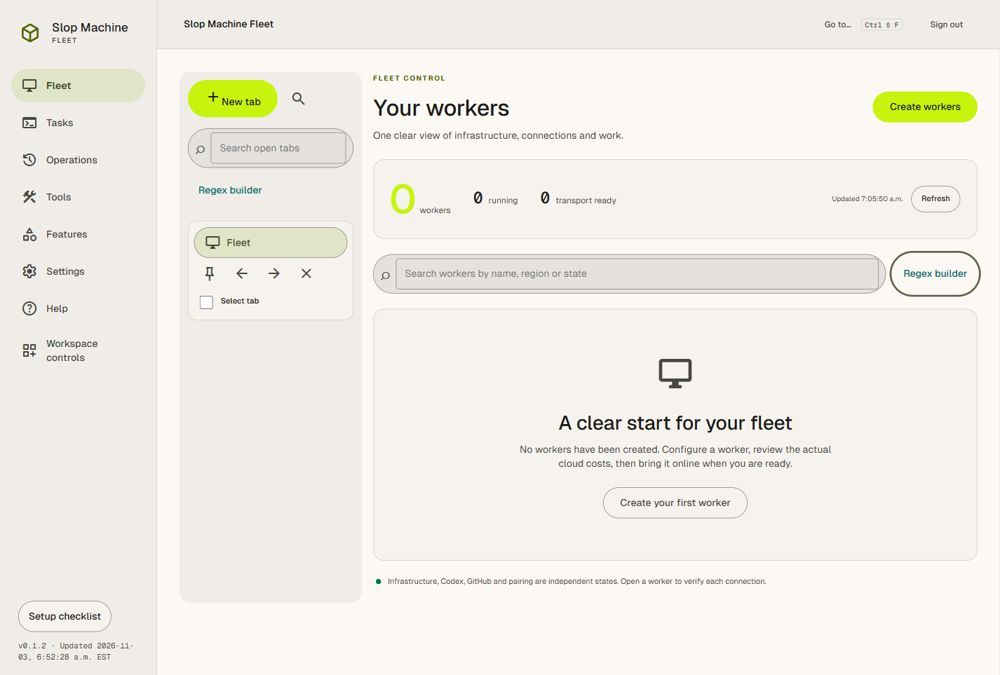
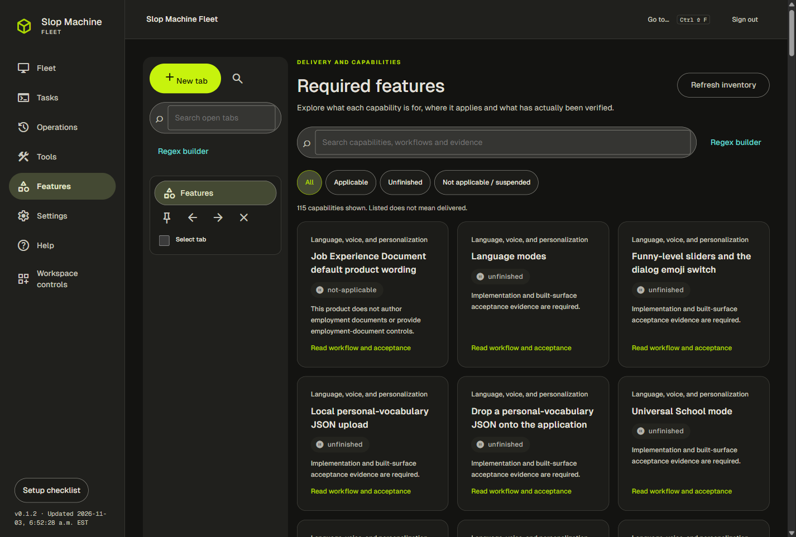
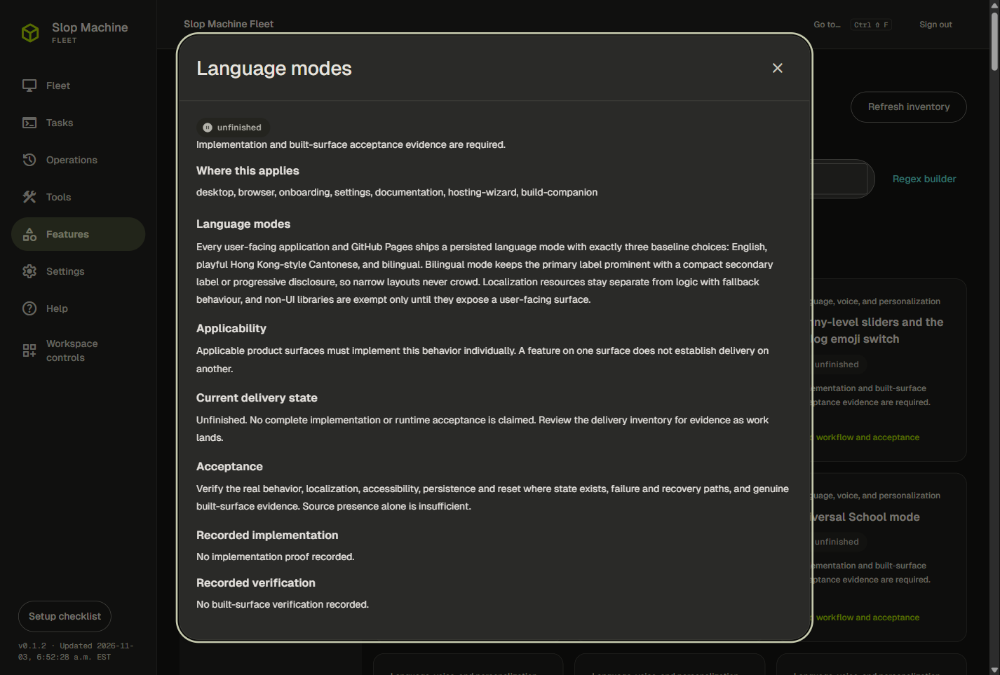
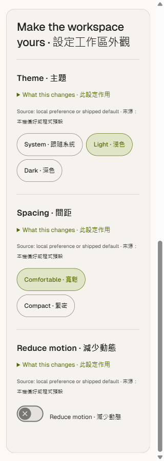
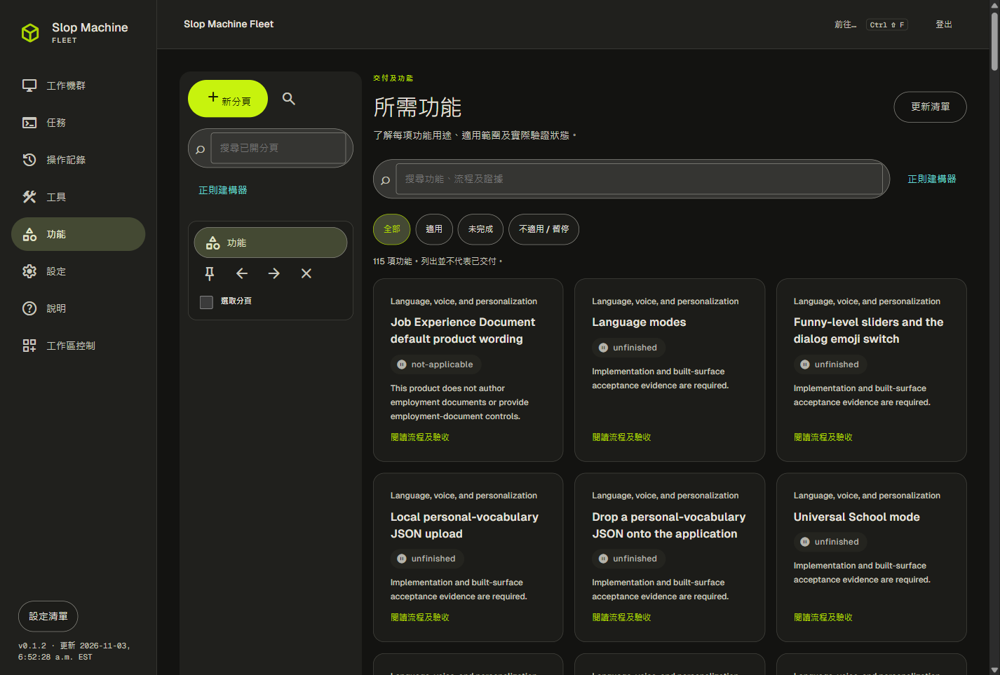

# Slop Machine Fleet

A desktop and self-hosted control plane for isolated Windows coding workers on Amazon EC2.

The shared service, Windows worker, desktop client and browser workspace are implemented in source. Delivery and acceptance are still in progress. No paid cloud resources have been created, and real worker login, pairing and a live coding turn remain unverified.

## Work with a fleet

- Create workers through an exact, expiring account, region, resource and cost review. Worker readiness requires bootstrap, certificate enrollment, SSM forwarding and mutual-TLS health verification.
- Complete guided Slop Machine device login and interactive GitHub CLI login under each worker's dedicated profile. Pairing-code issuance and a connected client have separate states.
- Queue coding tasks, handle actual approval requests, inspect bounded output and interrupt work deliberately.
- Select workers for individual or bulk lifecycle actions while preserving retained workspace volumes and ownership checks.

Read the complete [worker guide](docs/features/workers/README.md), [task-output guide](docs/features/workers/task-output.md), [hosting guide](deploy/README.md) and [API contract](docs/API.md). The [prepared wiki](docs/wiki/pending/Home.md) contains complete articles while forge-wiki initialization is pending.

## Build and host

Run `build.bat /s` for the supported build and `build-installer.bat /s` for the genuine unsigned Squirrel installer, worker and three portable companions. See the hosting guide before configuring `.env`, trusted LAN HTTPS and the source-bound worker release manifest. `host.bat --detached` and `host.bat --logs` retain separate background and interactive hosting modes.

The tracked Compose stack has now pulled and started successfully after local permission and IP-certificate selection repairs. A separate LAN computer verified the HTTPS health endpoint using the exact local CA and normal host-identity validation. Current-user browser and desktop trust remains an explicit setup choice; the detached entrypoint still reports incomplete when its native HTTPS check cannot establish that trust.

## Verified milestones and limits

- Source `939d26821e331919b43f0fa980a203d82ab7f1d6` passed both exact root entrypoints. Its local unsigned `Setup.exe` is 134,644,224 bytes.
- The source-bound service image was published, inspected and pulled at digest `sha256:0ce833cc40b2a19e7a645ff8e9642b7811bd2b0a2cdaad091a7d0099f7472042`.
- The rebuilt PostgreSQL-backed browser runtime displayed all 115 feature entries, opened complete articles, rejected anonymous encoded API routes, preserved drafts on cancelled navigation and verified targeted Settings focus and neutral wording reset.
- Normal release [build-41621036172-1](https://github.com/Ding-Ding-Projects/slop-machine-fleet/releases/tag/build-41621036172-1) declares version 0.1.1 and the stable/main channel. All eight payload files matched their published sizes and SHA-256 values; five executables were observed unsigned.
- The supported physical Windows installation was upgraded from 0.1.0 to accepted 0.1.1 through Squirrel Setup. Installed package, executable and archive matched the verified release, and direct native launch and keyboard focus were observed. The separate build cache remained unchanged; the legacy cache was restored from verified backups. This is installer-upgrade proof, with automatic-updater behavior still unfinished.

The [required-feature inventory](docs/features/requirements/README.md) retains unfinished capabilities, including full regex parity and the remaining tool suites. Five current browser screenshots have verified source, byte and privacy provenance. Full physical-scale coverage, native updates, complete companion acceptance and live cloud workflows remain unfinished. Design reference frames are not runtime screenshots. Follow the [roadmap](ROADMAP.md) and [handoff](HANDOFF.md) for exact remaining work.

## Current built browser views

These exact PNGs come from the compiled0.1.2 browser renderer at source `c0544f72554f877cbda1882179ff4bc002283d25`, captured on2026-11-03 UTC with real authenticated controller data and no created cloud workers. The producer held source, index and every built asset unchanged through teardown. They show current partial implementation, not completed cloud or required-feature acceptance. See [capture provenance and limits](docs/features/evidence/README.md).

