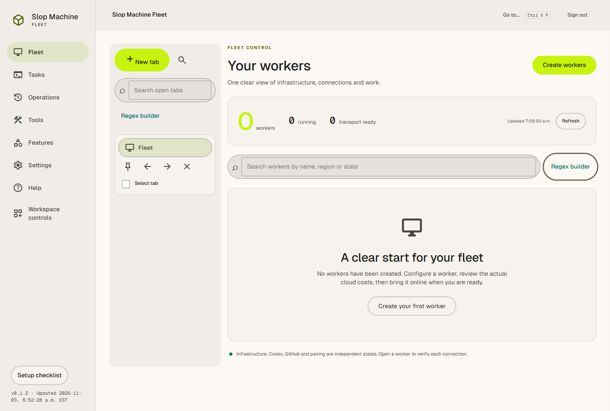
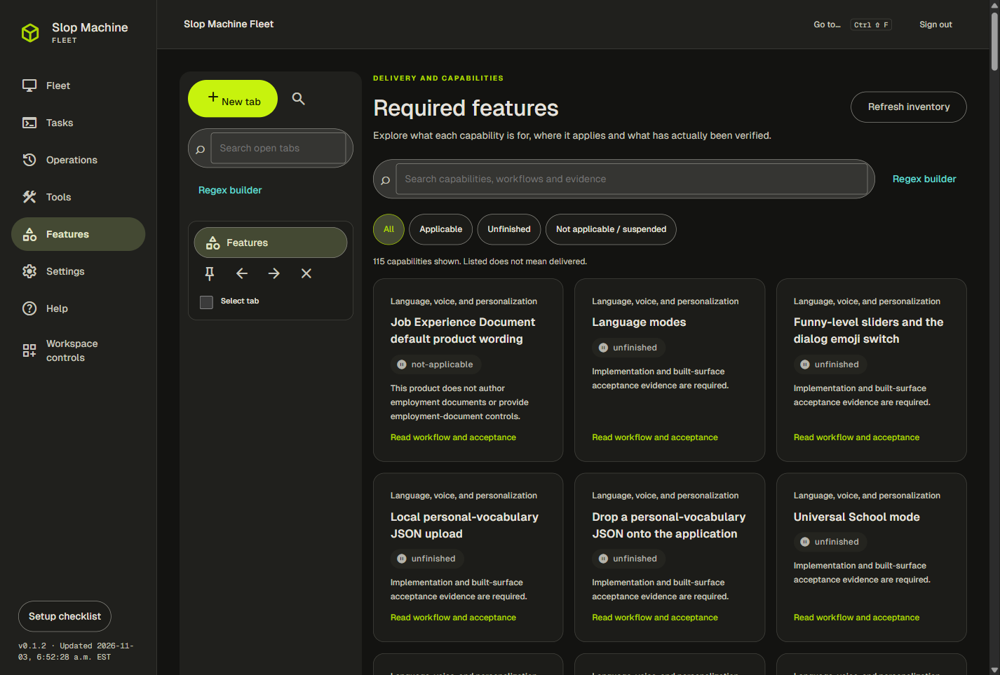
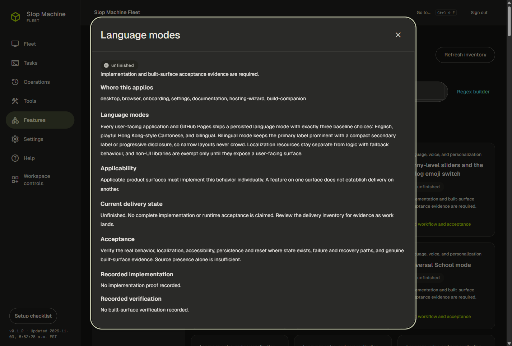
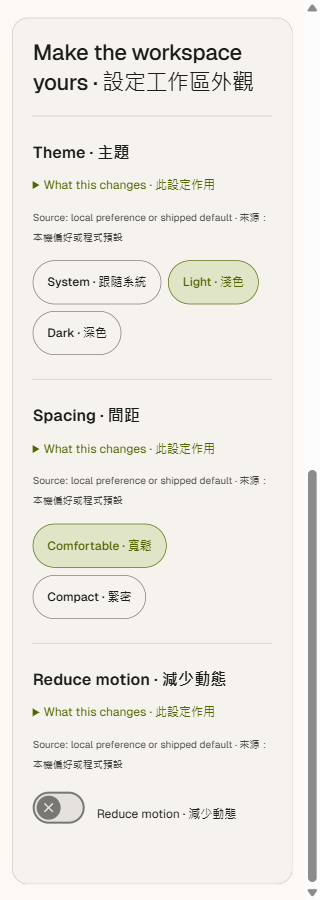
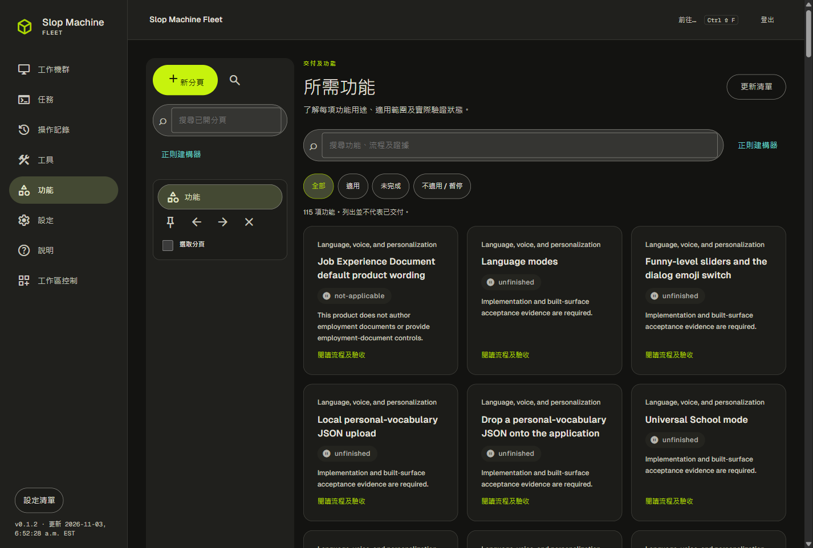

# Built browser evidence

## What these views show

The compiled browser renderer at source `c0544f72554f877cbda1882179ff4bc002283d25` displayed version0.1.2 and the actual build timestamp. The five source-bound PNGs were captured on2026-11-03 UTC. Their source/index and all seven built assets matched before capture, after capture and after owned browser teardown. The fleet is intentionally empty because no paid cloud worker has been created.

The views show the productive Fleet workspace, the115-entry required-feature inventory, a complete language article, bilingual appearance controls and Cantonese navigation around original English feature content. Actual interaction receipts include native background Tab and Escape plus real navigation, refresh and preference actions.

## Exact provenance

[The machine-readable inventory](../../capture-inventory.json) records each exact identity, source and renderer hashes, PNG hash, dimensions, state tuple, interaction-proof hash and inspection state. The renderer SHA-256 is `3989b89f6b9829bcb8862228ef302e56d948a13e429c5b57ee372aad678b8228`. Raw images, build/interaction/privacy receipts and owned-teardown records remain retained in the private verification inventory. Public images preserve the inspected raw bytes without crop, annotation, resizing or recompression.

## Limits that remain unfinished

Scale1 is browser device-pixel-ratio emulation on an observed144DPI host, not a physical100/125/150/200percent scale matrix. Prospective error-free intervals do not establish startup history or native diagnostics. Cantonese controls still surround English feature titles and article prose. The narrow scrolled appearance view hides the responsive footer; front-screen provenance and persistent navigation at all narrow states remain unfinished. These images do not prove installed-wrapper, automatic-updater, live account, cloud provisioning or complete required-feature acceptance.

## Inspected views

